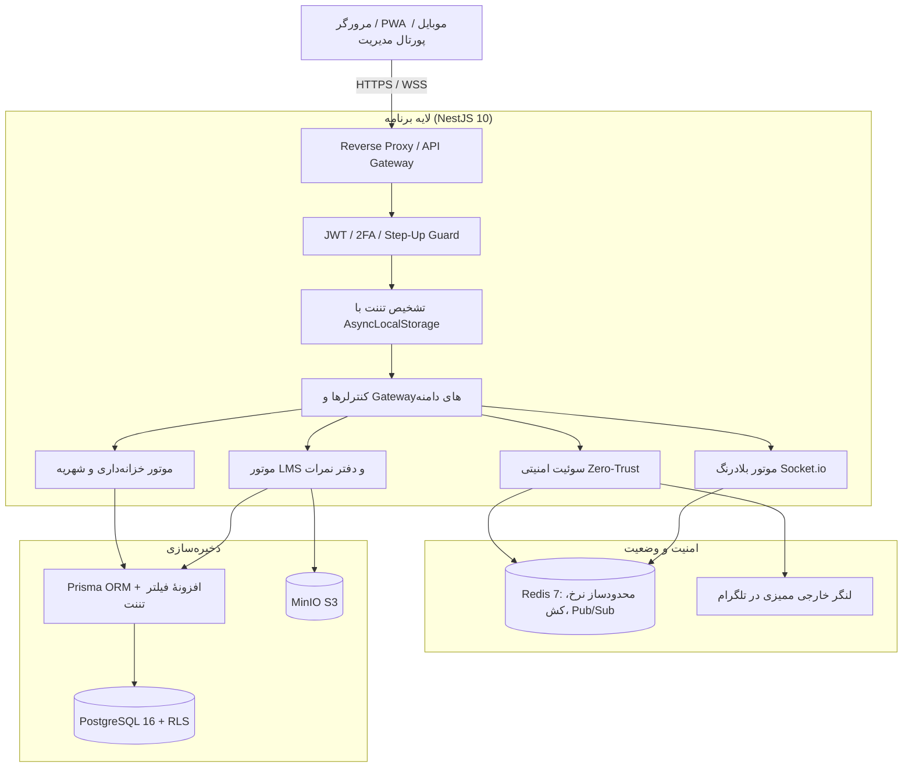

<p align="center">
  <a href="https://rokad.ir" target="_blank" rel="noopener noreferrer">
    <picture>
      <source media="(prefers-color-scheme: dark)" srcset="frontend/public/logo-rokad-white.svg">
      
    </picture>
  </a>
</p>

<h1 align="center">پلتفرم رکاد (Rokad Platform)</h1>

<p align="center">
  <strong>سیستم‌عامل چندمستأجره برای مدارس، هنرستان‌ها و آموزشگاه‌ها</strong><br/>
  ERP مدرسه · سامانه یادگیری (LMS) · خزانه‌داری و چک صیاد · چت بلادرنگ · PWA آفلاین‌محور
</p>

<p align="center">
  <a href="README.md"><strong>🇬🇧 Read in English</strong></a> ·
  <a href="ARCHITECTURE.md"><strong>سند معماری</strong></a> ·
  <a href="ROADMAP.md"><strong>نقشه راه</strong></a> ·
  <a href="CHANGELOG.md"><strong>تغییرات نسخه‌ها</strong></a>
</p>

<p align="center">
  <a href="LICENSE"></a>
  
  
  
  
  
  
  
</p>

---

<div dir="rtl">

## ✨ چرا رکاد؟

نرم‌افزارهای مدرسه معمولاً مجموعه‌ای پراکنده از برنامه‌های دسکتاپ، فایل‌های اکسل و گروه‌های پیام‌رسان هستند؛ بدون حفاظت جدی از داده‌ها و بدون همگام‌سازی لحظه‌ای. **رکاد** همهٔ این‌ها را در **یک پلتفرم ابری یکپارچه** جمع می‌کند که برای شیوهٔ واقعی کار مدارس ایران ساخته شده است: تقویم شمسی، تایپوگرافی فارسی، چک صیاد، درگاه زرین‌پال و تجربهٔ موبایل‌محور.

| | |
| :-- | :-- |
| 🛡️ **امنیت از ریشه** | رمزنگاری پاکتی اطلاعات هویتی، جستجوی کور، 2FA، احراز هویت ارتقایی و لاگ ضددستکاری |
| 🏢 **چندمستأجری واقعی** | جداسازی داده در دو لایه: هم در ORM و هم در هستهٔ پایگاه داده (PostgreSQL RLS) |
| 💰 **خزانه‌داری داخلی** | طرح شهریه، اقساط، چرخهٔ عمر چک صیاد، یادآوری سررسید و تسویهٔ آنلاین |
| 🎓 **آموزش کامل** | حضور و غیاب، دفتر نمرات، آزمون، تکلیف، طرح درس، مشاوره و بیشتر |
| 💬 **ارتباط بلادرنگ** | چت Socket.io روی چند سرور، وب‌پوش و پیامک |
| 📱 **PWA قابل نصب** | پشتیبانی آفلاین، رابط راست‌به‌چین و تجربهٔ Bottom Sheet برای موبایل |

---

## 🏗️ معماری

</div>



<div dir="rtl">

> جزئیات کامل طراحی و مدل جداسازی تننت‌ها در [ARCHITECTURE.md](ARCHITECTURE.md) آمده است.

<!-- 📸 اسکرین‌شات‌ها را اینجا اضافه کنید:
<p align="center">
  
  
</p>
-->

---

## 🌟 قابلیت‌های برجسته

### 🛡️ سوئیت امنیتی Zero-Trust

- **احراز هویت دومرحله‌ای (RFC 6238 TOTP):** سازگار با Google Authenticator و Microsoft Authenticator؛ کدهای بازیابی به‌صورت هش SHA-256 ذخیره می‌شوند.
- **احراز هویت ارتقایی (`StepUpGuard`):** عملیات حساس (تغییر نقش، حذف حساب، تغییر بدهی) نیازمند وارد کردن دوبارهٔ کد ۶ رقمی TOTP است.
- **رمزنگاری پاکتی AES-256-GCM:** اطلاعات هویتی مانند کد ملی و شماره تماس با کلید داده (DEK) اختصاصی هر رکورد رمز می‌شوند.
- **شاخص کور HMAC-SHA256:** جستجوی دقیق روی ستون‌های رمزنگاری‌شده، بدون رمزگشایی رکوردها.
- **لاگ ممیزی زنجیره‌ای ضددستکاری:** هر ورودی شامل `SHA-256(prevHash + payload)` است و یک کرون‌جاب، خلاصهٔ هش دفتر را به‌صورت دوره‌ای در کانال خصوصی تلگرام لنگر می‌کند؛ بنابراین هر دستکاری داخلی قابل اثبات است.
- **محدودساز نرخ و ضد بروت‌فورس:** پنجرهٔ لغزان روی Redis با جریمهٔ تدریجی و مسدودسازی IP.

### 💼 موتور خزانه‌داری و چک صیاد

- **دقت مالی کامل:** استفاده از `Decimal(15, 2)` در همه‌جا و حذف خطای ممیز شناور.
- **طرح شهریه (`FeePlan`):** تعریف در سطح `ALL_SCHOOL`، `EDUCATIONAL_LEVEL` یا `CLASSROOM` و ایجاد قرارداد دانش‌آموزان در یک تراکنش اتمیک.
- **دفتر چک صیاد (`FeePayment`):** اعتبارسنجی کد صیاد ۱۶ رقمی، سری، بانک، شعبه و تاریخ سررسید.

  </div>

  ```mermaid
  stateDiagram-v2
      [*] --> PENDING
      PENDING --> CASHED: سررسید و وصول
      PENDING --> BOUNCED: برگشت خورد
      BOUNCED --> REPLACED: چک جدید / وجه نقد
      CASHED --> [*]
      REPLACED --> [*]
  ```

  <div dir="rtl">

  | وضعیت | اثر |
  | :-- | :-- |
  | `PENDING` | در انتظار سررسید؛ بدون تغییر در مانده |
  | `CASHED` | کسر از بدهی و صدور رسید رسمی |
  | `BOUNCED` | فعال شدن `hasFinancialHold = true` |
  | `REPLACED` | اتصال به چک جایگزین یا پرداخت نقدی |

- **یادآوری سررسید:** کرون‌جاب روزانهٔ ساعت ۰۹:۰۰ (`ChequeReminderScheduler`) به والدین ۳ روز و ۱ روز قبل و صبح روز سررسید وب‌پوش و پیام درون‌برنامه‌ای می‌فرستد.
- **ورود دسته‌جمعی از اکسل:** اعتبارسنجی دومرحله‌ای (گزارش خطا با آدرس دقیق سلول، سپس ثبت اتمیک ردیف‌های معتبر).
- **پورتال والدین با سوئیچ چندفرزندی:** جابه‌جایی بین فرزندان، پیگیری اقساط و چک‌ها و پرداخت از طریق زرین‌پال.

### 🎓 عملیات آموزشی و LMS

- **برنامه‌ریزی درسی:** تخصیص دبیر، ماتریس دروس و تشخیص تداخل هفتگی.
- **دفتر نمرات هوشمند:** ارزشیابی مستمر با ضرایب، نمرات میان‌ترم و پایانی، درصدرتبهٔ کلاسی و صدور کارنامهٔ PDF با یک کلیک.
- **آزمون آنلاین و بانک سؤال:** آزمون چندگزینه‌ای و تشریحی زمان‌دار، تصحیح خودکار و ردیابی خروج از پنجرهٔ آزمون (ضدتقلب).
- **درگاه تکلیف:** بارگذاری فایل (MinIO)، شمارندهٔ مهلت و ارزیابی با روبریک.
- **حضور و غیاب:** ثبت هر زنگ با اعلان فوری غیبت به والدین.

### 💬 ارتباطات و PWA

- **چت Socket.io:** گروه‌های کلاسی، اطلاعیه‌ها و گفتگوی دبیر و ولی، همگام روی چند سرور با `@socket.io/redis-adapter`.
- **وب‌پوش VAPID:** اعلان مرورگر حتی وقتی تب بسته است.
- **رزرو جلسات اولیا و مربیان:** تقویم تعاملی برای جلسات حضوری یا آنلاین.
- **PWA آفلاین‌محور:** کش Workbox، راه‌اندازی سریع و نصب روی موبایل.

### 🏢 عملیات SaaS

- **جداسازی دولایهٔ تننت:** افزونه‌های کوئری Prisma به‌علاوهٔ Row-Level Security در PostgreSQL.
- **کنسول سوپرادمین:** پایش زندهٔ PostgreSQL، Redis، MinIO، حافظهٔ Heap و CPU.
- **ساخت تننت با یک کلیک:** هم‌ترازی اسکیما، توزیع نقش‌های اولیه و اتصال ساب‌دامین اختصاصی.

---

## 🧩 ماژول‌های ۳۱‌گانه

بک‌اند از **۳۱ ماژول مستقل NestJS** تشکیل شده و فرانت‌اند آن‌ها را از طریق داشبوردهای نقش‌محور (سوپرادمین، مدیر مدرسه، دبیر، دانش‌آموز/ولی، باشگاه، پلتفرم کا) نمایش می‌دهد.

<details>
<summary><strong>🔐 زیرساخت و امنیت (۷)</strong></summary>

| ماژول | مسئولیت |
| :-- | :-- |
| `tenants` | جداسازی تننت، برندینگ (پسرانه، دخترانه، اکوسیستم)، ساب‌دامین |
| `saas-admin` | ساخت تننت، اشتراک‌ها، شبیه‌سازی کاربر، سهمیه‌ها |
| `auth` | چرخش Token Family، 2FA، گاوصندوق رمز |
| `rbac` | نقش‌های پویا و استثنای دسترسی |
| `feature-flags` | فعال/غیرفعال‌سازی ماژول‌ها برای هر تننت |
| `audit-log` | ممیزی با لنگر رمزنگاری |
| `health` | سلامت، آمادگی و ضربان Redis/DB |

</details>

<details>
<summary><strong>🏫 هستهٔ ERP و عملیات (۱۱)</strong></summary>

| ماژول | مسئولیت |
| :-- | :-- |
| `academic` | سال تحصیلی، ترم‌ها، رشته‌ها |
| `classes` | دروس، کلاس‌ها، برنامهٔ هفتگی |
| `members` | دانش‌آموزان، دبیران، کارکنان، اولیا (با پیوند ولی–دانش‌آموز) |
| `profiles` | رسانه، بیوگرافی، وبلاگ اجتماعی داخلی |
| `attendance` | حضور و غیاب گروهی، تاریخچه، اعلان به اولیا |
| `calendar` | رویدادها و برنامه‌ها (شمسی/میلادی) |
| `homework` | ایجاد، بارگذاری و بازبینی تکالیف |
| `matters` | پرونده‌های انضباطی: امتیاز، اقدام، اطلاع به اولیا |
| `parent-visits` | بازه‌ها و رزرو جلسات اولیا |
| `polls` | فرم‌ها و تحلیل نتایج |
| `coaching` | مربی‌گری دانش‌آموز، پایش سلامت و تحصیل |

</details>

<details>
<summary><strong>📚 LMS و ارزشیابی (۵)</strong></summary>

| ماژول | مسئولیت |
| :-- | :-- |
| `question-bank` | مخزن سؤالات قابل‌استفادهٔ مجدد |
| `exams` | موتور آزمون آنلاین و شرکت‌کنندگان |
| `gradebook` | نمره‌دهی ماتریسی، کارنامه، پرونده |
| `lesson-plans` | سرفصل دبیر و پیگیری جلسات |
| `learning-materials` | منابع مطالعاتی امن روی S3/MinIO |

</details>

<details>
<summary><strong>💰 مالی و منابع انسانی (۲)</strong></summary>

| ماژول | مسئولیت |
| :-- | :-- |
| `finance` | طرح شهریه، اقساط، چک صیاد، ورود دسته‌جمعی، زرین‌پال |
| `payroll` | قرارداد دبیران، فیش حقوقی پویا، خروجی‌ها |

</details>

<details>
<summary><strong>📣 ارتباطات (۴)</strong></summary>

| ماژول | مسئولیت |
| :-- | :-- |
| `messages` | صندوق رسمی داخلی |
| `chat` | پیام‌رسانی بلادرنگ کلاسی و مستقیم |
| `notifications` | اعلان درون‌برنامه‌ای و وب‌پوش |
| `sms` | اتصال به آموت و صف پیامک |

</details>

<details>
<summary><strong>🎮 زندگی دانش‌آموزی و بازی‌وارسازی (۲)</strong></summary>

| ماژول | مسئولیت |
| :-- | :-- |
| `ka` | اقتصاد مجازی، ثبت فعالیت، پاداش، جدول امتیازات |
| `club` | باشگاه‌های دانش‌آموزی، چالش‌ها، تأیید دبیر |

</details>

---

## 🔒 مشخصات رمزنگاری

| حوزه | استاندارد | مشخصات |
| :-- | :-- | :-- |
| **رمز عبور** | Argon2id | حافظه ۶۴ مگابایت (`m=65536`)، ۳ تکرار (`t=3`)، ۴ نخ موازی |
| **رمزنگاری PII** | AES-256-GCM | الگوی پاکتی، کلید ۲۵۶ بیتی، IV تصادفی ۹۶ بیتی، تگ احراز ۱۲۸ بیتی |
| **جستجوی رمزنگاری‌شده** | HMAC-SHA256 | شاخص کور با فلفل سمت سرور (`BLIND_INDEX_PEPPER`) |
| **احراز دومرحله‌ای** | RFC 6238 TOTP | HMAC-SHA1، گام ۳۰ ثانیه، تلورانس ±۱ پنجره، کدهای پشتیبان ۸ کاراکتری |
| **یکپارچگی ممیزی** | زنجیرهٔ هش SHA-256 | پیوند هش قبلی و انتشار دوره‌ای خلاصه در بستر خارجی |
| **توکن‌ها** | JWT (RS256 / HS256) | اعتبارسنجی سخت‌گیرانهٔ issuer/audience و لیست سیاه Redis برای توکن‌های ابطال‌شده |

آسیب‌پذیری پیدا کرده‌اید؟ [سیاست امنیتی](.github/SECURITY.md) را ببینید.

---

## 🛠️ پشتهٔ فناوری

| لایه | فناوری |
| :-- | :-- |
| بک‌اند | NestJS 10، TypeScript 5.7 |
| پایگاه داده / ORM | PostgreSQL 16، Prisma 5.22 |
| کش و صف | Redis 7 (ioredis، `@socket.io/redis-adapter`) |
| ذخیره‌سازی فایل | MinIO (سازگار با S3) |
| فرانت‌اند | React 18، Vite 6، Tailwind CSS (PWA، RTL) |
| بلادرنگ | Socket.io 4.8 |
| زمان‌بندی | `@nestjs/schedule` (Cron) |
| مستندات API | OpenAPI 3.0 / Swagger UI |
| زیرساخت | Docker و Docker Compose |

---

## ⚡ راه‌اندازی سریع

**پیش‌نیازها:** Node.js نسخهٔ ۲۰ یا ۲۲ · pnpm نسخهٔ ۹ (`npm i -g pnpm`) · Docker و Docker Compose

</div>

```bash
# ۱. کلون پروژه و نصب پکیج‌ها
git clone https://github.com/Rokad-Studio/Rokad-Platform.git
cd Rokad-Platform
pnpm install

# ۲. اجرای PostgreSQL 16، Redis 7 و MinIO
docker-compose up -d

# ۳. تنظیم محیط (مقادیر پیش‌فرض با docker-compose.yml هماهنگ‌اند)
cp .env.example .env

# ۴. تولید کلاینت، همگام‌سازی اسکیما و سید اولیه
pnpm prisma:generate
pnpm prisma db push
pnpm prisma:seed
```

<div dir="rtl">

سپس دو سرور را در دو ترمینال جدا اجرا کنید:

| ترمینال | دستور | آدرس |
| :-- | :-- | :-- |
| بک‌اند (NestJS) | `pnpm start:dev` | API: `http://localhost:4000/api/v1` · Swagger: `http://localhost:4000/api/docs` |
| فرانت‌اند (Vite PWA) | `pnpm --filter rokad-frontend dev` | `http://localhost:3000` |

---

## 🔑 حساب‌های تستی

پس از اجرای `pnpm prisma:seed`، همهٔ نقش‌های زیر با رمز عبور **`Admin@123456`** قابل ورود هستند.

| نقش | شماره موبایل | امکانات قابل آزمایش |
| :-- | :-- | :-- |
| **سوپرادمین** | `09120000001` | ساخت تننت، سلامت سیستم |
| **مدیر مدرسه** | `09120000002` | ترم‌ها، منابع انسانی، قراردادهای شهریه، دفتر چک صیاد |
| **دبیر** | `09120000003` | دفتر نمرات، حضور و غیاب، طرح سؤال آزمون |
| **ولی دانش‌آموز** | `09120000004` | شهریه چندفرزندی، پرداخت آنلاین، پیگیری چک |
| **دانش‌آموز** | `09120000005` | تکلیف، آزمون آنلاین، برنامهٔ هفتگی |

> ⚠️ **فقط برای توسعهٔ محلی.** این اطلاعات ورود را هرگز در محیط تست یا production استفاده نکنید و پیش از استقرار، همهٔ رمزها و کلیدها را تغییر دهید.

---

## 📁 ساختار پروژه

</div>

```text
rokad-platform/
├── .github/                 # CI، CodeQL، برچسب‌گذار، قالب‌ها، SECURITY.md، Dependabot
├── prisma/                  # schema.prisma + seed.ts
├── src/                     # بک‌اند (NestJS 10)
│   ├── common/
│   │   ├── crypto/          # رمزنگاری پاکتی AES-256-GCM و شاخص کور HMAC
│   │   ├── guards/          # JwtAuth، Roles، Permissions، StepUp
│   │   └── constants/       # کاتالوگ دسترسی‌های RBAC
│   └── modules/             # ۳۱ ماژول دامنه (auth، finance، gradebook، chat، ...)
├── frontend/                # React 18 + Vite 6 PWA
│   └── src/
│       ├── components/ui/   # سیستم طراحی راست‌به‌چین
│       ├── modules/         # super-admin · school-admin · teacher · student-parent
│       └── lib/api/         # کلاینت Axios با نوسازی خودکار JWT
├── docker-compose.yml       # PostgreSQL، Redis، MinIO
├── ARCHITECTURE.md · ROADMAP.md · CHANGELOG.md · CONTRIBUTING.md
├── CODE_OF_CONDUCT.md · LICENSE · README.md
└── package.json
```

<div dir="rtl">

---

## 📚 مستندات API

مستندات تعاملی OpenAPI 3.0 روی **[http://localhost:4000/api/docs](http://localhost:4000/api/docs)** در دسترس است. روی **Authorize** بزنید و توکن JWT خود را وارد کنید تا بتوانید endpointهای محافظت‌شده را فراخوانی کنید.

---

## 🧪 تست

</div>

```bash
pnpm test                          # تست‌های واحد
pnpm test:e2e                      # تست‌های انتها‌به‌انتها
pnpm build                         # بررسی نوع و بیلد بک‌اند
pnpm --filter rokad-frontend build # بیلد فرانت‌اند
npx prisma validate                # اعتبارسنجی اسکیما
npx ts-node scratch/test-finance-engine.ts   # بررسی محاسبات خزانه‌داری
```

<div dir="rtl">

در CI تست‌ها روی سرویس‌های واقعی PostgreSQL و Redis اجرا می‌شوند و CodeQL هر تغییر را از نظر امنیتی بررسی می‌کند.

---

## 🤝 مشارکت

مشارکت شما را خوشحال می‌کند. لطفاً پیش از ارسال Pull Request این موارد را بخوانید:

- [CONTRIBUTING.md](CONTRIBUTING.md): روند کار و Conventional Commits
- [CODE_OF_CONDUCT.md](CODE_OF_CONDUCT.md)
- [سیاست امنیتی](.github/SECURITY.md): گزارش مسئولانهٔ آسیب‌پذیری

---

## 📄 مجوز

این پروژه تحت [مجوز MIT](LICENSE) منتشر شده است.

</div>

<p align="center">
  <sub>ساخته‌شده با 💚 توسط تیم <strong>استودیو رکاد (Rokad Studio)</strong></sub>
</p>